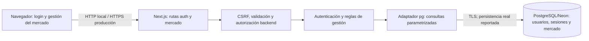

# Formalización del Mercado La Parada

Informe central de la PC2 de Proyecto Final de Carrera III. Estado al 2026-11-21: cinco épicas y once historias creadas y verificadas en Jira; E1–E5 implementadas localmente. Última auditoría local: 80 pruebas en nueve archivos, lint y TypeScript aprobados. El último build aprobado corresponde a la ejecución anterior con 73 pruebas; no se repitió durante la auditoría para evitar generar artefactos. El usuario confirmó autenticación, roles y persistencia en Neon mediante una operación real. Esta evidencia es REAL REPORTADA, no una nueva ejecución del agente; capturas, operación exacta y trazabilidad de migraciones pendientes de adjuntar. Este documento se completa con evidencia durante el desarrollo; todavía no constituye una entrega cerrada.

La evaluación se desarrolla de 19:00 a 23:30, America/Lima: 270 minutos, conforme a la aclaración del docente comunicada por el estudiante. El tiempo de 120 minutos del enunciado y el plan anterior de 230 minutos no aplican. Alcance aprobado: cinco épicas, once historias, 27 SP.

Convenciones de evidencia:

- **REAL:** operación ejecutada y resultado observado por el agente. Se identifica cuando corresponde a una ejecución anterior de esta sesión.
- **REAL REPORTADA:** ejecución comunicada por el usuario; logs, enlaces o capturas pendientes cuando no se han inspeccionado.
- **SIMULADA:** datos o avance de una simulación académica; nunca equivalen a desarrollo, pruebas o despliegues reales.
- **PENDIENTE:** actividad o evidencia todavía no verificada.

## 1. Product Backlog y Jira — 5 puntos

### Caso y alcance

El caso describe comercio sin registro, desorganización, problemas de salubridad y conflictos en La Parada. La solución propuesta organiza comerciantes y puestos y permite seguir requisitos de formalización mediante expedientes. El sistema registra seguimiento administrativo; no otorga autorizaciones legales municipales ni acredita resolver todos los problemas del caso.

Administrador: gestión de comerciantes, puestos y expedientes. Supervisor: consulta de expedientes e indicadores, sin escritura. No hay registro público de usuarios. Se utilizarán datos ficticios en la demostración.

### Proyecto y épicas verificadas

**REAL:** integración Jira consultada; proyecto `FDMLP`, nombre `Formalización del Mercado La Parada`, ID `10034`. La consulta inicial devolvió únicamente la historia de prueba `FDMLP-1`; no existían épicas. Se crearon las cinco siguientes y una consulta posterior confirmó claves, tipo Epic, descripciones y objetivos. Todas figuran en estado `Por hacer`; no se realizaron transiciones.

Sitio verificado: https://claudiobances03.atlassian.net. Los enlaces de incidencias siguientes se construyen con ese dominio y las claves confirmadas por Jira; el acceso del docente está pendiente de comprobación.

| Épica | Clave y enlace | Objetivo de negocio | Historias / SP |
| --- | --- | --- | --- |
| E1 — Acceso y seguridad | [FDMLP-2](https://claudiobances03.atlassian.net/browse/FDMLP-2) | Proteger registros y expedientes mediante identificación y responsabilidades por rol | H1–H3 / 7 |
| E2 — Padrón de comerciantes | [FDMLP-3](https://claudiobances03.atlassian.net/browse/FDMLP-3) | Identificar participantes frente al comercio sin registro | H4–H5 / 5 |
| E3 — Gestión de puestos | [FDMLP-4](https://claudiobances03.atlassian.net/browse/FDMLP-4) | Ordenar espacios y evitar ocupaciones duplicadas | H6–H7 / 5 |
| E4 — Seguimiento de formalización | [FDMLP-5](https://claudiobances03.atlassian.net/browse/FDMLP-5) | Hacer visibles los requisitos pendientes y el avance administrativo | H8–H9 / 5 |
| E5 — Supervisión e indicadores | [FDMLP-6](https://claudiobances03.atlassian.net/browse/FDMLP-6) | Priorizar revisiones con información consolidada y trazable | H10–H11 / 5 |

Cada épica contiene nombre, descripción funcional y objetivo de negocio. **FDMLP-1 es una prueba y queda excluida de las funcionalidades, los SP y la velocidad.**

### Historias y trazabilidad

**REAL:** once historias creadas y verificadas por lectura directa de cada incidencia: épica padre, Story point estimate (`customfield_10016`) y etiquetas MoSCoW. Todas incluyen descripción y criterios Dado/Cuando/Entonces. Una búsqueda JQL inmediata no las devolvió; se verificaron por clave sin repetir creaciones. H1–H11 son identificadores del backlog; las claves Jira aparecen en la tabla. No se realizaron transiciones ni se declara Done por la sola implementación local. SP acordados mediante estimación inicial; no se afirma haber celebrado una sesión de planning poker. Prioridad mediante MoSCoW.

| Historia | Formulación | SP | Prioridad | Épica Jira | Estado local |
| --- | --- | ---: | --- | --- | --- |
| H1 / [FDMLP-7](https://claudiobances03.atlassian.net/browse/FDMLP-7) | Como usuario autorizado, quiero iniciar sesión para acceder de forma segura | 3 | Must | FDMLP-2 | Implementada; evidencia detallada por historia pendiente |
| H2 / [FDMLP-8](https://claudiobances03.atlassian.net/browse/FDMLP-8) | Como responsable del sistema, quiero controlar permisos por rol para impedir accesos indebidos | 3 | Must | FDMLP-2 | Implementada; evidencia detallada por historia pendiente |
| H3 / [FDMLP-9](https://claudiobances03.atlassian.net/browse/FDMLP-9) | Como usuario autenticado, quiero cerrar sesión para terminar mi acceso | 1 | Must | FDMLP-2 | Implementada; evidencia detallada por historia pendiente |
| H4 / [FDMLP-10](https://claudiobances03.atlassian.net/browse/FDMLP-10) | Como administrador, quiero registrar comerciantes para mantener un padrón | 3 | Must | FDMLP-3 | Implementada; evidencia detallada por historia pendiente |
| H5 / [FDMLP-11](https://claudiobances03.atlassian.net/browse/FDMLP-11) | Como administrador, quiero consultar y buscar comerciantes para localizar sus fichas | 2 | Must | FDMLP-3 | Implementada; evidencia detallada por historia pendiente |
| H6 / [FDMLP-12](https://claudiobances03.atlassian.net/browse/FDMLP-12) | Como administrador, quiero registrar puestos para identificar los espacios del mercado | 2 | Must | FDMLP-4 | Implementada; evidencia detallada por historia pendiente |
| H7 / [FDMLP-13](https://claudiobances03.atlassian.net/browse/FDMLP-13) | Como administrador, quiero asignar puestos sin duplicidades para conocer su ocupación | 3 | Must | FDMLP-4 | Implementada; evidencia detallada por historia pendiente |
| H8 / [FDMLP-14](https://claudiobances03.atlassian.net/browse/FDMLP-14) | Como administrador, quiero registrar requisitos del expediente para identificar pendientes | 3 | Must | FDMLP-5 | Implementada; evidencia detallada por historia pendiente |
| H9 / [FDMLP-15](https://claudiobances03.atlassian.net/browse/FDMLP-15) | Como administrador, quiero actualizar el estado del expediente para seguir la formalización | 2 | Must | FDMLP-5 | Implementada; evidencia detallada por historia pendiente |
| H10 / [FDMLP-16](https://claudiobances03.atlassian.net/browse/FDMLP-16) | Como supervisor, quiero filtrar expedientes pendientes para priorizar revisiones | 3 | Should | FDMLP-6 | Implementada; evidencia detallada por historia pendiente |
| H11 / [FDMLP-17](https://claudiobances03.atlassian.net/browse/FDMLP-17) | Como supervisor, quiero consultar indicadores por estado para conocer el avance | 2 | Should | FDMLP-6 | Implementada; evidencia detallada por historia pendiente |
| Total | Once historias | 27 | | | |

Criterios de aceptación resumidos para completar en cada historia:

- H1: Dado un usuario activo con credenciales válidas, cuando inicia sesión, entonces obtiene una sesión nueva; credenciales inválidas no la generan.
- H2: Dada una sesión de supervisor, cuando solicita una operación administrativa, entonces el backend responde 403; sin sesión válida responde 401.
- H3: Dada una sesión válida, cuando cierra sesión con protección CSRF válida, entonces se revoca y su token no permite reingresar.
- H4: Dado un comerciante existente, cuando se intenta repetir su identificación, entonces se rechaza el duplicado.
- H5: Dado un comerciante registrado, cuando se busca su identificación, entonces aparece su ficha.
- H6: Dado un código de puesto existente, cuando se repite, entonces se rechaza.
- H7: Dado un puesto ocupado, cuando se intenta otra asignación simultánea, entonces se impide.
- H8: Dado un expediente, cuando se registra un requisito cumplido, entonces el cambio persiste.
- H9: Dado un expediente con requisitos pendientes, cuando se intenta marcar completo, entonces se rechaza.
- H10: Dados expedientes de distintos estados, cuando el supervisor filtra pendientes, entonces obtiene solo los correspondientes sin poder modificarlos.
- H11: Dados expedientes registrados, cuando se consulta el resumen, entonces los totales coinciden con los registros.

Evidencias pendientes: **[CAPTURA P1-A: cinco épicas]**, **[CAPTURA P1-B: backlog con SP, prioridad y vínculo]**, **[CAPTURA P1-C: historia con aceptación]**. Registrar el enlace específico del proyecto compartido y comprobar acceso del docente.

## 2. Cuatro sprints, burndown, velocidad, Kanban y Gantt — 5 puntos

Plan de simulación académica propuesto; no se han creado sprints ni simulado transiciones en esta tarea. No confundir estas semanas con las 4 horas y 30 minutos de evaluación.

| Sprint simulado | Duración propuesta | Sprint goal | Sprint backlog | SP |
| --- | --- | --- | --- | ---: |
| S1 | 5 días | Proteger el acceso al sistema | H1, H2, H3 | 7 |
| S2 | 5 días | Disponer de un padrón consultable | H4, H5 | 5 |
| S3 | 5 días | Vincular espacios y seguimiento administrativo | H6, H7, H8, H9 | 10 |
| S4 | 5 días | Supervisar pendientes e indicadores | H10, H11 | 5 |

Fechas de inicio/fin: **PENDIENTES de definir**. S3 tiene mayor carga estimada; su asignación requiere justificar capacidad y dependencias. Total planificado: 27 SP; velocidad obtenida todavía no calculada.

- Burndown: registrar SP restantes por día en cada sprint y comparar con la línea ideal. Etiquetar la serie observada como **avance simulado**, no como ejecución histórica real. No hay gráficos ni datos de avance todavía.
- Velocidad: sumar SP de historias que cumplen la definición de terminado en cada sprint simulado; no contar historias parcialmente terminadas ni FDMLP-1.
- Kanban: To Do / In Progress / In Review / Done; propuesta WIP 1 en progreso y 1 en revisión. Configuración y capturas del flujo por sprint pendientes.
- Gantt: incluir épicas e historias con fechas, dependencias e hitos. H2 depende de H1; H7 depende de H4/H6; H9 de H8; H10/H11 de los expedientes. El acceso seguro precede a las operaciones protegidas. Hitos propuestos: acceso, padrón, puestos/expedientes, supervisión.
- Definición de terminado propuesta: aceptación satisfecha, autorización backend, pruebas relevantes y controles locales aprobados; integración real y evidencia cuando corresponda. El usuario reporta autenticación, roles y persistencia reales en Neon; falta adjuntar la evidencia de aceptación por historia.

Espacios de evidencia: **[P2-A: cuatro sprint goals/backlogs]**, **[P2-B1–B4: burndowns y velocidades simuladas]**, **[P2-C: Gantt fechado]**, **[P2-D1–D4: flujo Kanban y WIP por sprint]**.

## 3. Arquitectura lógica, stack y DevSecOps — 5 puntos

### Arquitectura y decisiones técnicas

Una aplicación en la raíz del repositorio: Next.js App Router, React, TypeScript y backend Node.js. PostgreSQL mediante `pg`, sin ORM. Se reutiliza la infraestructura disponible; no se implementan microservicios ni contenedores de aplicación.



Frontend y rutas de E1–E5 implementados localmente. El usuario confirmó una operación real con persistencia en Neon, además de autenticación y roles. El agente no volvió a conectar ni inspeccionó el catálogo remoto. Las migraciones definen users, sessions, merchants, stalls, dossiers y dossier_requirements; el estado exacto del esquema y de cada migración requiere evidencia del entorno probado.

| Decisión implementada en E1 | Propósito y evidencia local |
| --- | --- |
| scrypt N=32768, r=8, p=3, sal aleatoria | Evitar contraseñas en texto plano; `lib/password.mjs` |
| Token opaco de 32 bytes; SHA-256 almacenado | No almacenar el token de sesión en claro; `lib/auth.ts` |
| Expiración absoluta de ocho horas y revocación | Invalidar sesiones vencidas y cerradas; consulta a BD en cada validación |
| Cookies HttpOnly, SameSite=Strict y Secure en producción | Restringir exposición de sesión; prefijo __Host- en producción |
| CSRF mediante origen, cookie y cabecera coincidentes | Proteger login y logout; no depender solo de la interfaz |
| Autorización backend read/write | Rechazar escritura del supervisor; endpoint administrativo de comprobación sin funciones E2–E5 |
| Consultas parametrizadas, TLS y errores saneados | Reducir inyección y exposición de datos de conexión |
| Bloqueo temporal tras cinco fallos | Limitar intentos consecutivos por cuenta; 15 minutos |
| Alta administrativa, sin registro público | `scripts/create-user.mjs`, contraseña interactiva oculta; no ejecutado |

Migraciones preparadas: `migrations/001_access_security.sql` (usuarios y sesiones) y `migrations/002_market_management.sql` (comerciantes, puestos, expedientes y requisitos). **No se ejecutaron migraciones ni altas remotas desde el agente.** El usuario reporta funcionamiento real; registrar qué migraciones y usuarios fueron preparados externamente antes de asumir pendientes o repetir comandos. No repetir una migración ya aplicada.

### Reglas de E2–E5 implementadas localmente

- H4/H5: DNI de ocho dígitos, nombre y rubro validados, DNI único y búsqueda parametrizada por nombre/DNI. Alta de comerciante, expediente y tres requisitos en una sola transacción.
- H6/H7: código de puesto único, asignación condicional atómica y UNIQUE en merchant_id. Alcance mínimo: un puesto por comerciante; no se implementan reasignaciones ni bajas. La concurrencia real sigue pendiente de prueba en PostgreSQL.
- H8/H9: tres requisitos académicos: identificación registrada, declaración de actividad y revisión sanitaria. Estados pendiente/en_revision/completo; cierre solo con los tres cumplidos. Bloqueo FOR UPDATE del expediente para serializar cambios; reabrir antes de quitar requisitos de uno completo.
- H10/H11: consulta por estado y filtro pendientes de cierre (pendiente + en_revision); contadores agregados desde la BD, incluyendo ceros cuando no hay registros.
- Permisos: padrón y puestos exclusivos de administrador; expedientes e indicadores consultables por ambos roles; toda escritura de negocio exige administrador, sesión y CSRF. Los datos se solicitan al backend, sin fallback de persistencia ficticia.
- Se extrajo `lib/http-security.ts` para compartir sesión, CSRF y validación JSON con E1; sus pruebas continúan pasando. No hay nuevas dependencias ni cambios de workflows.

| API | Operaciones | Permisos |
| --- | --- | --- |
| /api/merchants | GET, POST | Administrador |
| /api/stalls | GET, POST | Administrador |
| /api/stalls/assign | POST | Administrador + CSRF |
| /api/dossiers | GET | Administrador/supervisor |
| /api/dossiers/requirements | PATCH | Administrador + CSRF |
| /api/dossiers/status | PATCH | Administrador + CSRF |
| /api/indicators | GET | Administrador/supervisor |

POST de comerciantes y puestos también exige CSRF. Todas las respuestas privadas usan Cache-Control: no-store; errores de BD se presentan sin detalles sensibles.

### Ciclo de vida y seguridad por fase

| Fase | Herramientas disponibles | Seguridad y estado |
| --- | --- | --- |
| Plan | Jira | Aceptación, roles y prioridades; cinco épicas y once historias reales, 27 SP verificados |
| Code | GitHub, TypeScript, ESLint | Revisión de cambios y tipado; rama test verificada, PR pendiente |
| Build | npm ci, Next.js, Actions | Lockfile e instalación reproducible; build local E1–E5 aprobado |
| Test | Vitest | 80 pruebas de acceso, reglas y herramienta de migraciones; almacenamiento simulado en la suite |
| Release | GitHub, PR test → main | Revisión y controles antes de integrar; no ejecutado para E1 |
| Deploy | Vercel, Actions manual | Secretos del servicio y despliegue autorizado; versión E1 pendiente |
| Operate | Vercel y PostgreSQL | Sesiones revocables, TLS y errores saneados; operación real reportada por el usuario; capturas pendientes |
| Monitor | Logs Vercel, revisión ZAP | Revisar errores sin secretos y hallazgos dinámicos; sin monitorización continua acreditada |

El padrón y los expedientes requieren control de acceso por contener información administrativa. Next.js permite un flujo integrado pequeño; PostgreSQL aporta integridad relacional para las asignaciones; las pruebas y la revisión temprana de seguridad reducen errores antes de publicar.

Evidencias pendientes: **[P3-A: diagrama exportado]**, **[P3-B: modelo de datos preparado, aplicación remota pendiente]**, **[P3-C: explicación del stack y controles por fase]**. El diagrama Mermaid anterior describe E1–E5 y señala su integración pendiente.

## 4. GitHub, CI/CD, seguridad, pruebas y despliegue — 5 puntos

### Repositorio y estrategia de ramas

**REAL, comprobación local en esta tarea:** rama activa `test`; `origin` es `https://github.com/cbances03/la-parada-devsecops.git`. Repositorio identificado por ese remoto: [la-parada-devsecops](https://github.com/cbances03/la-parada-devsecops). No se consultó su acceso remoto ni el del docente.

Estrategia acordada: desarrollo y pruebas en `test`, PR hacia `main` como producción. Commits descriptivos y PR verificables pendientes para E1; no se crearon commits, pushes ni PR en esta tarea. No se atribuyen a main los cambios locales.

### Pipeline disponible

- `ci.yml`: checkout, Node 22.19.0, npm ci, lint, typecheck, Vitest y build; se activa en PR, push a main o ejecución manual. Un push aislado a test no activa el disparador push actual.
- `security.yml`: npm audit con umbral high y Gitleaks mediante contenedor con salida redactada. Mismos disparadores principales que CI.
- `codeql.yml`: análisis JavaScript/TypeScript condicionado a ENABLE_CODEQL=true; la disponibilidad de Code Scanning sigue siendo necesaria.
- `deploy.yml`: ejecución manual autorizada desde main, controles locales/audit y preview Vercel. No es un despliegue automático a producción tras cada push.
- `zap.yml`: baseline manual sobre destino HTTPS expresamente autorizado, con informes como artefactos.

No se modificaron workflows. YAML presente no equivale a ejecución exitosa; el despliegue requiere autorización separada.

### Resultados y límites de la evidencia

| Estado | Comando o actividad | Resultado y procedencia |
| --- | --- | --- |
| REAL, auditoría previa a commits | npm.cmd run lint; tsc --noEmit --incremental false; vitest run --no-cache --configLoader runner | Aprobados: 80 pruebas en nueve archivos y controles estáticos; sin consultas ni escrituras de Neon. Build no repetido |
| REAL REPORTADA, validación manual del usuario | Autenticación, roles y persistencia en Neon | El usuario confirmó funcionamiento local y persistencia mediante una operación real. Sin nueva consulta del agente; operación concreta, capturas y logs saneados pendientes |
| REAL, ejecución local E1–E5 | npm.cmd run check | Exit 0: ESLint sin warnings, TypeScript, 73 pruebas en ocho archivos y Next build aprobados. Sin conexión SQL de los tests ni migraciones |
| REAL, componentes SIMULADOS | Nuevas pruebas E2–E5 | Validación, permisos backend de ambos roles, CSRF, errores saneados, rechazo de cierre incompleto, reapertura y contratos de transacción. No acreditan DDL ni concurrencia reales |
| REAL, ejecución anterior de E1 en esta sesión | npm.cmd run check | Exit 0: ESLint sin warnings, TypeScript, 35 pruebas en cinco archivos y Next build aprobados. No reejecutado en esta tarea documental |
| REAL con almacenamiento SIMULADO | Vitest de E1 | scrypt real; sesiones, CSRF, expiración, revocación y roles probados con dobles de servicio/BD. No acredita PostgreSQL real |
| REAL, ejecución anterior de E1 | node --check de create-user.mjs, password.mjs y auth-store.mjs | Sintaxis aprobada; no se ejecutó el aprovisionamiento |
| REAL, ejecución anterior de E1 | git diff --check | Sin errores de whitespace; avisos LF/CRLF, sin cambio de configuración |
| REAL REPORTADA, ensayo previo | npm ci y npm audit --audit-level=high | Finalizaron correctamente; no prueban ausencia total de vulnerabilidades |
| REAL REPORTADA, ensayo previo | Actions CI y dependencias/secretos | Aprobados; faltan enlaces de runs y evidencia de la versión final |
| REAL REPORTADA, ensayo previo | Vercel | Despliegue correcto; URL de la solución final pendiente de registrar/verificar |
| REAL REPORTADA, ensayo previo | ZAP | Ejecutado con 11 categorías de advertencias; impacto y correcciones pendientes |
| REAL REPORTADA, bloqueo previo | CodeQL | No pudo ejecutarse por falta de Code Scanning en el repositorio privado; sin SAST aprobado |
| PENDIENTE | Evidencia detallada de PostgreSQL | Adjuntar operación real reportada, esquema/migraciones aplicadas y aceptación por historia. Concurrencia, expiración y replay de logout no se dan por verificados sin evidencia |
| PENDIENTE | CI/CD de la versión final | PR, runs, controles de seguridad y despliegue accesible |

Archivos de pruebas disponibles: `tests/auth.test.ts`, `tests/auth-http.test.ts`, `tests/auth-store.test.ts`, `tests/password.test.ts`, `tests/check-db.test.ts`, `tests/market.test.ts`, `tests/market-http.test.ts` y `tests/market-store.test.ts` y `tests/db-migrations.test.ts`. La suite usa dobles de PostgreSQL; su resultado es independiente de la operación real reportada por el usuario.

### Capturas, enlaces y cierre pendientes

- **[P4-A]** Ramas main/test, commits y PR con revisión y checks.
- **[P4-B]** Ejecución CI de la versión final con build y resultados de pruebas visibles; registrar URL real del run y commit.
- **[P4-C]** Audit y escaneo de secretos; registrar enlace al run. Conservar el bloqueo CodeQL sin presentarlo como aprobación.
- **[P4-D]** Solución final desplegada y prueba de acceso; URL pública pendiente. Capturar interfaz y errores de permisos sin contraseñas, tokens ni cookies.
- **[P4-E]** Informe ZAP con las advertencias y su evaluación, únicamente sobre destino autorizado.
- **[ENTREGA]** Compartir GitHub, proyecto Jira y solución con el docente y comprobar acceso. El enunciado descuenta un punto por cada enlace no compartido.
- **[ENTREGA]** Preparar ZIP del código final sin .env, credenciales, dependencias ni artefactos sensibles. ZIP todavía no generado.
- **[DEFENSA]** Preparar explicación presencial de cada pregunta; una respuesta insatisfactoria elimina el puntaje de esa pregunta según el enunciado.

Siguiente paso: capturar backlog real con SP y padres; completar fechas, burndown, Gantt y flujo simulado; registrar la operación real reportada y comprobar cuáles migraciones ya fueron aplicadas antes de cualquier ejecución adicional autorizada. Esta actualización creó las once historias, implementó E2–E5 y actualizó el informe. No ejecutó migraciones remotas, commits, pushes ni despliegues.

### Preparación de la validación real de PostgreSQL

**REAL, revisión local sin conexión a Neon:** las migraciones 001 y 002 se revisaron contra lib/auth-store.mjs y lib/market-store.mjs. No se modificó ni leyó .env.local. La variable exacta consumida por el backend es **DATABASE_URL**; la herramienta manual reutiliza connectionOptions para TLS con certificado verificado y TLS mínimo 1.2.

| Migración | Integridad e índices revisados | Resultado estático |
| --- | --- | --- |
| 001_access_security.sql | PK users.id y sessions.token_hash; email UNIQUE normalizado; roles limitados; intentos no negativos; token hexadecimal y expiración posterior al alta. FK sessions.user_id → users.id; índices por user_id y expires_at | Compatible con login, bloqueo temporal, creación, consulta y revocación de sesiones |
| 002_market_management.sql | DNI y código únicos; stalls.merchant_id UNIQUE y FK; dossiers.merchant_id UNIQUE y FK; PK compuesta de requisitos; estados y códigos restringidos; índice de estado | Compatible con alta transaccional, asignación condicional, filtros, agregación JSON e indicadores |

PK y UNIQUE crean índices que también cubren las referencias de puestos, expedientes y requisitos. sessions.user_id tiene índice explícito. No se añade un índice de búsqueda ILIKE para el volumen mínimo del examen.

Ambos archivos contienen únicamente CREATE TABLE/INDEX entre BEGIN y COMMIT: no hay DROP, TRUNCATE, DELETE, UPDATE ni modificación de tablas existentes. ON DELETE CASCADE define el comportamiento de futuras eliminaciones de usuarios/sesiones y expedientes/requisitos; no elimina datos al aplicar la migración. No se requirieron correcciones al SQL.

Límites identificados:

- Los archivos no son idempotentes y no existe un historial de migraciones. Una tabla presente no demuestra que toda la migración esté aplicada o que su definición sea compatible.
- El cierre con tres requisitos y el bloqueo de cambios de un expediente completo se controlan en transacciones del backend con FOR UPDATE; no son una restricción cruzada de tablas en PostgreSQL. Su funcionamiento real y la concurrencia requieren pruebas integradas.
- El código usa nombres de tablas sin esquema explícito. La herramienta exige current_schema() = public; si no coincide, se detiene para evitar crear objetos donde el backend no los encuentre.

Se preparó **scripts/db-migrations.mjs**, sin nuevas dependencias. inspect usa BEGIN READ ONLY y ROLLBACK; consulta únicamente catálogo, columnas, restricciones e índices, sin filas de usuarios, hashes, tokens ni datos de negocio. Los estados son AUSENTE, OBJETOS_PRESENTES_REVISAR y PARCIAL_BLOQUEADA. La presencia no se registra como historial ni se basa automáticamente.

apply exige un identificador fijo 001/002; rechaza cualquier objeto objetivo existente, exige las tablas iniciales antes de 002 y utiliza una transacción con bloqueo asesor y límites de espera. Un fallo revierte la migración seleccionada. No aplica ambas por defecto, no repara esquemas parciales ni altera tablas existentes. La inspección de objetos presentes requiere comparar sus definiciones en Neon con el SQL versionado, incluidos CHECK, valores predeterminados e índices; el resumen de catálogo no acredita equivalencia completa.

**REAL, validación local nueva:** node --check de la herramienta aprobado; lint y TypeScript aprobados; siete pruebas de tests/db-migrations.test.ts aprobadas con catálogo/cliente SQL simulados. Cubren inspección de solo lectura, orden, objetos parciales/presentes, aplicación seleccionada y rollback. No se ejecutó la herramienta contra Neon ni se aplicó DDL real.

#### Procedimiento CMD externo

Primero confirmar en Neon que la conexión corresponde a la base/rama del ensayo autorizada. Desde CMD externo:

```bat
cd /d D:\ISW-USIL-2026-2\PFCIII\PCII\DevOps-Examen
node --env-file=.env.local scripts/db-migrations.mjs inspect
```

Interpretación: AUSENTE indica que no hay objetos objetivo; PARCIAL_BLOQUEADA exige detenerse y revisar sin borrar ni recrear; OBJETOS_PRESENTES_REVISAR exige comparar la definición existente y omitir el archivo si es compatible. No compartir salidas que incluyan credenciales; esta herramienta no imprime cadenas de conexión ni errores del driver.

**Solo después de autorización de escritura y únicamente para las migraciones ausentes**, ejecutar por separado y detenerse ante cualquier fallo:

```bat
node --env-file=.env.local scripts/db-migrations.mjs apply 001
node --env-file=.env.local scripts/db-migrations.mjs apply 002
node --env-file=.env.local scripts/db-migrations.mjs inspect
```

Si 001 ya está aplicada y verificada, omitir su comando. Si ambos grupos están presentes y compatibles, no ejecutar ningún apply. No hacer DROP ni usar CREATE IF NOT EXISTS para ocultar diferencias. Evidencias pendientes: salida saneada de inspect antes/después, resultado de cada apply realmente ejecutado y confirmación de las restricciones existentes.

#### Creación de administrador y supervisor

**REAL, revisión y prueba local negativa de scripts/create-user.mjs:** acepta únicamente administrador/supervisor, normaliza el correo, valida entradas, requiere TTY y confirmación de contraseña de 12–128 caracteres. Usa scrypt con sal aleatoria e INSERT parametrizado; no sobreescribe usuarios existentes. Se ejecutó sin --env-file con datos sintéticos y contraseñas distintas: ambas entradas quedaron ocultas en la terminal y terminó con código 1 antes del hash, la conexión o cualquier escritura. Esto valida el rechazo seguro, no un alta real. Las pruebas previas de password.test.ts verificaron scrypt real. El usuario reportó después autenticación y roles funcionando; registrar las altas efectivamente realizadas y no recrear usuarios existentes.

Después de aplicar/verificar 001 y contar con autorización, ejecutar dos veces:

```bat
node --env-file=.env.local scripts/create-user.mjs
node --env-file=.env.local scripts/create-user.mjs
```

En la primera ejecución indicar correo de prueba y rol administrador; en la segunda otro correo y rol supervisor. Elegir contraseñas distintas, introducirlas únicamente en los prompts ocultos y no guardarlas en capturas, comandos, frontend, informe o Jira. No volver a crear un correo existente para cambiar su contraseña: el script no realiza actualizaciones. Evidencia pendiente: mensaje de alta correcta por rol, sin contraseña ni cadena de conexión.

#### Lista mínima de pruebas integradas y evidencia por completar

Iniciar localmente con npm.cmd run dev y abrir http://localhost:3000. Usar únicamente registros ficticios y capturar resultados saneados.

| Prueba | Resultado esperado / evidencia pendiente |
| --- | --- |
| Login | Credenciales correctas permiten acceso de cada rol; contraseña incorrecta no crea sesión; cinco fallos bloquean temporalmente la cuenta de prueba |
| Sesión y logout | Recargar conserva sesión válida; cerrar sesión impide volver a consultar con el token anterior. Capturar códigos, nunca valores de cookies |
| Roles y CSRF | Sin sesión: 401. Supervisor: expedientes/indicadores 200 y escrituras/padrón/puestos 403. Escritura de administrador sin CSRF o desde otro origen: 403 |
| Comerciantes | Alta persiste tras recargar; búsqueda por DNI/nombre; campos vacíos/DNI inválido rechazados y duplicado 409. Se crea un expediente con tres requisitos |
| Puestos/asignación | Alta y código único; asignación persiste; puesto ocupado o comerciante ya asignado rechazados. Dos intentos concurrentes no generan doble ocupación |
| Expedientes | Cumplimiento de requisitos persiste; cierre incompleto 409; cierre con tres requisitos permitido; quitar un requisito de completo exige reabrir |
| Filtros e indicadores | Pendientes de cierre incluye pendiente y en_revision; completo queda fuera. Total coincide con la suma de estados. Si ya hay registros, comparar incrementos, no asumir base vacía |

La cookie Secure y el prefijo __Host- se verifican con HTTPS en producción; en npm run dev local se usan cookies HttpOnly/SameSite sin Secure. No se debe declarar verificada la configuración HTTPS solo con una prueba HTTP local.

La preparación PostgreSQL anterior no realizó operaciones remotas. Posteriormente el usuario confirmó autenticación, roles y persistencia en Neon mediante una operación real. Se autorizaron cinco commits locales trazables en test; push, PR, despliegues y nuevas escrituras remotas siguen fuera de alcance. El informe conserva como pendientes únicamente las evidencias y verificaciones no suministradas.
